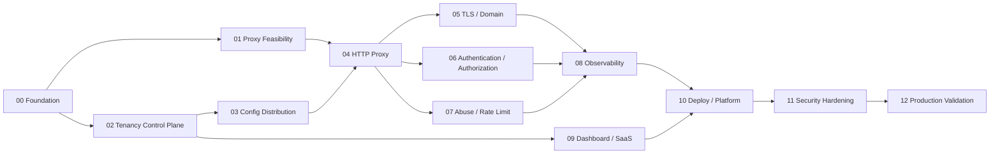

# MASTER AGENT PLAN — AegisGate

**Input for coding orchestration agent**. Đọc tài liệu cùng thư mục. Tên dự án tạm: `aegisgate`. Ngày thiết kế: 2026-11-11.

## 1. Product objective

Xây dựng API Gateway + Security SaaS thương mại với:

- Go control plane cho organizations, tenants, domains, origins, routes, policies, usage, audit, deployment orchestration.
- Rust data plane (Pingora, pending feasibility gate) cho HTTP reverse proxy, TLS termination, auth filters, route policy, quotas, health and connection management.
- Next.js tenant dashboard + API/SDK, audit, analytics và billing adapters.
- Multi-tenant isolation từ DB đến edge config, metrics, logs và billing.
- Một vùng triển khai (single region) với hai hoặc nhiều edge replicas sau upstream L3/L4 protection khi ra production; mở rộng multi-region sau khi có benchmark và nhu cầu.

### Explicit non-goals for MVP

- Không tự xây TCP/IP stack, BGP Anycast, kernel firewall hay L3/L4 volumetric scrubbing.
- Không hứa WAF đầy đủ, bot detection ML, CAPTCHA challenge, mTLS tới mọi upstream, gRPC transcoding hay HTTP/3.
- Không tự viết cryptographic primitives, JWT implementation hoặc TLS stack.
- Không tạo payment processor; tích hợp billing provider theo interface.
- Không hỗ trợ arbitrary private origins qua public edge. Private upstream connectivity là enterprise extension cần thiết kế tunnel riêng.

## 2. Product milestones

| Milestone | Outcome | Prerequisite | Gate |
|---|---|---|---|
| M0 Discovery & feasibility | RFC, initial security model, Pingora spike | — | Confirm dynamic SNI cert + hot reload, WS, gRPC, TLS upstream |
| M1 Secure proxy MVP | Host/path reverse proxy + tenant config | M0 | E2E happy/negative path, unknown hosts denied |
| M2 Managed security | TLS, JWT, API keys, route policies, rate limits | M1 | Security suite + cert lifecycle + abuse tests |
| M3 SaaS MVP | Dashboard, onboarding, audit, usage, billing ledger | M2 | No cross-tenant access; invoice idempotency |
| M4 Production candidate | HA, backup, telemetry, rollback, load, incident runbooks | M3 | All QUALITY_GATES pass and security signoff |
| M5 GA/Expansion | WAF rule packages, multi-region, private origin connectivity | M4 | New ADR, capacity and threat reviews |

## 3. Dependency graph

**Parallelism:** 01 và 02 có thể chạy song song sau 00; 05/06/07 có thể chạy song song sau 04 (nhưng cùng hợp đồng filter chain). 09 có thể chạy sau 02 + API schema ổn định. Chỉ merge sau khi contract + integration tests pass.

## 4. Agent module directory

1. `agents/00-foundation-contracts.md` — repo layout, CI, ADRs, coding standards, schema/test harness.
2. `agents/01-pingora-feasibility.md` — feasibility proof: TLS SNI, cert reload, HTTP/2, WS, gRPC, health, timeout.
3. `agents/02-tenancy-control-plane.md` — identities, tenants, organizations, API routes, origin registry, audit, migrations.
4. `agents/03-config-distribution.md` — versioned snapshots, validation, signatures, secure propagation, ACK/NACK/LKG.
5. `agents/04-edge-proxy.md` — runtime proxy, routing, upstream, protection limits, safe retry, headers.
6. `agents/05-tls-domain.md` — domain ownership, automated issuance/renewal, certificate inventory/rotation.
7. `agents/06-identity-access.md` — management RBAC, API-key/JWT/JWKS policies, fail closed, origin identity.
8. `agents/07-rate-limit-ddos.md` — layered limits, anomaly heuristics, distributed counters, upstream integration.
9. `agents/08-observability-metering.md` — OTel, cardinality discipline, audit, tenant usage and aggregation.
10. `agents/09-saas-dashboard.md` — onboarding UX, tenants, policies, metering, subscriptions, billing adapter.
11. `agents/10-infrastructure-operations.md` — local compose, Kubernetes, GitOps, backups, runbooks.
12. `agents/11-security-hardening.md` — threat-driven negative tests, fuzz, SSRF/host, secret handling, supply-chain.
13. `agents/12-production-validation.md` — load/soak, failure injections, SLO evidence, release gating, docs.

## 5. Agent work contract (mandatory)

For every module:

1. Read README, this master, relevant docs, applicable AGENTS.md and existing implementation. Never assume empty repo.
2. Produce concise `implementation plan` referencing actual paths; note uncertainties and ADR impact.
3. Implement in small commits; code + unit + integration + security/negative tests + docs in same PR.
4. No broken stubs, fake security, hidden bypasses, hardcoded credentials, ephemeral in-memory admin state presented as durable.
5. Feature must be guarded by tests and documented configuration. Avoid unbounded queues and unsafe default limits.
6. Update OpenAPI/JSON Schema/protobuf and client types together if contract changes.
7. Run formatting, static checks, build, unit, integration and negative tests available in repo. Capture actual command output.
8. Produce `Agent Report`: paths changed, decisions, tests executed/passed/failed, remaining risks, next prerequisites.
9. If feasibility blocker occurs, STOP that module, document reproducible evidence, propose two alternatives; do not silently replace technology.
10. Production deployments, live DNS, paid cloud and billing require explicit human approval. Never open real public listeners or run disruptive tests against third-party hosts.

## 6. Design invariants that override feature requests

- Requests are mapped to one **verified** `(tenant_id, hostname, listener, route)`; tenant binding never taken from untrusted headers.
- Unknown SNI/Host, mismatched authority, disabled tenant or incomplete policy: reject deterministically and log aggregate reason (avoid leaking tenant existence).
- Control plane outage: keep validated LKG snapshot; control plane unavailable does not bypass auth/rate policy. Policy revocation delivery SLO monitored, emergency deny has documented local override.
- Config snapshots are immutable and checked: schema version, monotonic generation, tenant scoping, hash/signature, staged apply, ACK/NACK, bounded memory.
- No raw TLS private keys in PostgreSQL, config buses, telemetry or general edge config JSON. Cert material restricted to secret delivery mechanism and memory-bound cert store.
- Origin URLs are validated against SSRF rules, with DNS resolution and socket destination validation at **dial time**. Default block private/link-local/loopback/metadata networks for public SaaS edge (unless separately approved private-connect product).
- Redis/cache or auth policy backend outage must have explicit, per-feature fail policy. Authentication: fail closed. Global rate limiting: configurable conservative local fallback with alarms, no unlimited bypass.
- Admin actions are RBAC-authorized, tenant-filtered and audited; background jobs carry tenant scope.
- Billing usage uses durable dedupe id and reconciliation; no financial calculations from Prometheus counters alone.
- Never claim L3/L4 volumetric DDoS protection without upstream provider/network solution.

## 7. MVP acceptance scenarios

1. Tenant A creates domain `api.a.example` via ownership TXT, configures origin `https://origin-a.example`, enables HTTPS, routes `/v1/*`.
2. A valid client request reaches Rust edge, matches verified host/route, validates JWT, applies rate policy and proxies with TLS validation to origin.
3. A missing token is denied; malformed token is denied; expired token is denied; unknown JWT kid triggers bounded refresh but not bypass.
4. A second tenant cannot read, edit, route or view A's traffic data, even through changed URL IDs, Host/SNI confusion or job endpoints.
5. Control plane loses network: edge serves LKG; unhealthy or unsigned config is rejected; service remains ready for existing routes.
6. Rate overflow returns 429 with bounded response; upstream timeout returns controlled 504; no retry for non-idempotent requests by default.
7. Certificate renews and rotates without dropping established valid sessions; invalid/expired cert state alerts before expiry.
8. Usage ledger records billable requests using deterministic idempotency; reconciles with edge request counters within declared tolerance.
9. A compromised admin session is bounded by RBAC, audit, rotation/revocation controls and separate permission to change security-critical settings.
10. Load, outage, rollback, disaster-recovery and on-call drills pass documented thresholds.

## 8. Cost-first environment plan

- `local`: compose with Go, Rust, Postgres, Redis, NATS, demo origin, OTel collector, Prometheus/Grafana optional; local certificates only.
- `staging`: small Kubernetes cluster, managed or operator-backed Postgres, one region, load-test endpoint isolated from production, no chargeable external traffic tests.
- `production`: upstream DDoS protection (provider edge/load balancer), redundant edge pods/nodes, multi-zone if available, backups/object storage, monitored cert automation and isolated secret storage.
- Avoid ClickHouse, service mesh, Kafka and global Anycast in v1 unless measured capacity demands them.

## 9. Definition of Done for complete project

All agent DoDs satisfied AND `docs/QUALITY_GATES.md` production release matrix has real evidence. Required human review: cloud costs, third-party security assessment or equivalent scoped professional review, privacy/data retention, incident response, legal/commercial terms, payment handling and operational ownership.

**The orchestrator must not label it 'production-ready' until these gates pass with evidence.**
