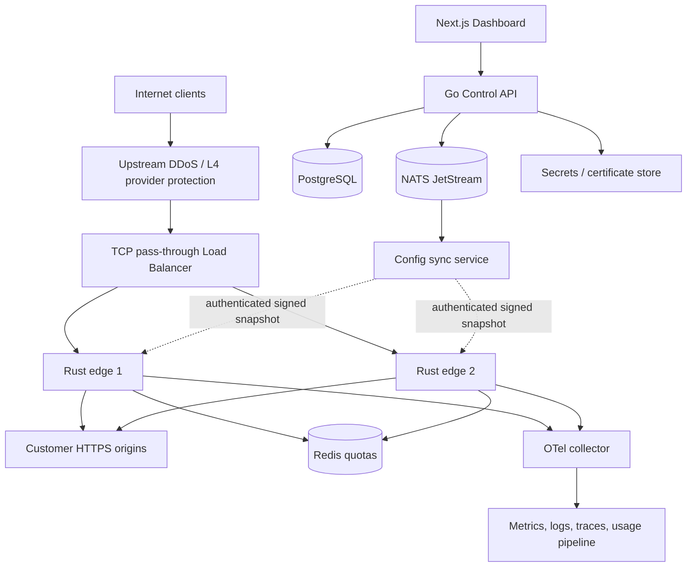
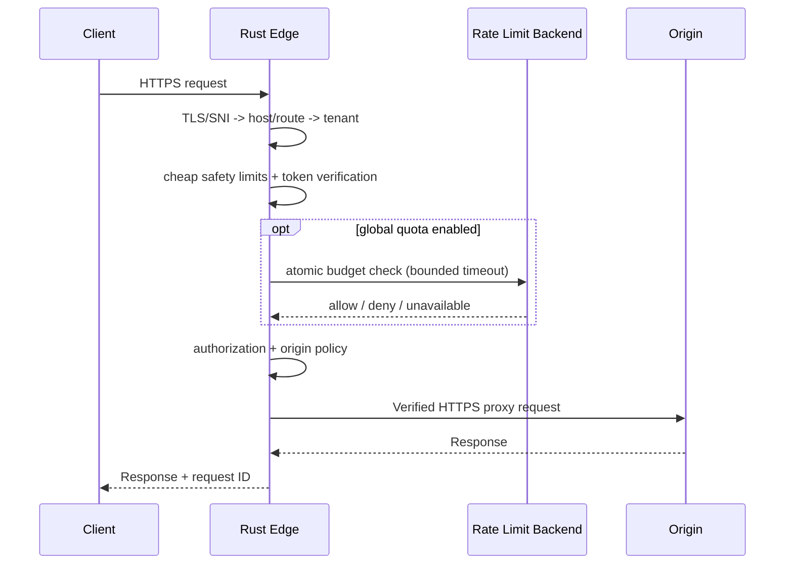

# Technical Architecture

## A. Why two planes?

The **Rust data plane** processes latency-sensitive traffic and reads immutable compiled policy snapshots. The **Go control plane** owns business state, administrative APIs, tenant authorization, orchestration and config publishing. Neither tenant dashboard nor PostgreSQL needs to be online to proxy a request with a validated cached policy.

This diagram shows the logical flow. Cloud edge products may terminate/re-encrypt TLS; in that deployment the peer trust and original client IP rules MUST be configured explicitly. The initial preferred design uses L4 pass-through so the Rust edge terminates tenant TLS itself.

## B. External traffic request lifecycle

1. Before TLS: enforce network connection caps and coarse accept filters; do not trust client address headers.
2. TLS handshake: pick certificate by verified SNI; unsupported or unregistered SNI rejected. Dynamic SNI must pass Pingora capability spike.
3. HTTP parse/framing: reject malformed, ambiguous or oversized messages; strict HTTP/1.1 Content-Length/Transfer-Encoding handling using standard stack.
4. Authority normalization: normalize host, port, IDNA; reject Host/SNI mismatch (421 where appropriate), duplicate ambiguous Host, unsupported schemes; never select tenant from X-Forwarded-Host.
5. Route lookup in immutable snapshot, matched by tenant-owned verified host + explicit path/method priority.
6. Cheap controls: header/body size, concurrency, per-route request limits, IP subnet rules and global fail-safe caps.
7. Authentication: required API key or JWT/JWKS (alg/kid/iss/aud/exp/nbf validated); no fallback to anonymous when policy says auth required.
8. Authorization: route and scope/role claims, deny precedence, tenant-specific policy; application retains object-level authorization responsibility.
9. Origin selection: validated endpoint, health status and weights; DNS/IP policy checked at dial; upstream TLS hostname/certificate verified.
10. Proxy with streaming backpressure, bounded buffers and timeouts, accurate correlation IDs; retries only when semantically safe.
11. Sanitized telemetry + deduplicated usage emission, async bounded queues; drop observability samples before blocking all customer traffic according to configured priorities.

## C. Config publication lifecycle

Go API validates tenant changes; Postgres transaction stores a versioned revision and outbox. Event consumer compiles snapshot, schema-validates + signs digest, stores immutable artifact, posts notification. Authenticated edge agents fetch version, verify signature/tenant boundaries, instantiate route/policy tables in staging, atomically swap live tables, ACK with hash/status. Rollback means publishing a newer generation derived from an older approved revision. If rejected, previous live version remains active with alert. Per-node ACK state enables staged rollouts and blast-radius control. Full specification: `CONFIG_PROTOCOL.md`.

## D. Control plane modules

- Identity/API: OIDC for operators, organizations, memberships, role policies, short-lived sessions and CSRF protection.
- Tenant provisioning: reserve identifiers, verified domains, origin ownership and quotas.
- Routes: one canonical URL authority, route collision checks, method/path priority, upstream pools.
- Security policy service: declarative JSON DSL, reject unknown operators, policy lint, preview and deterministic evaluation tests.
- PKI orchestrator: domain proof, ACME job, renewal, private key references, revocation/rotation audit.
- Publisher: outbox worker, snapshots, digest/signature, rollout states, ACK/NACK and revert.
- Usage/billing: append-only dedupe ledger + aggregate + external provider adapter.
- Operator controls: incident kill switch, provider integration, audited emergency block that bypasses normal release backlog with break-glass protections.

## E. Edge runtime modules

- Listener/TLS: socket, ALPN, SNI callback, in-memory certificate store, bounded handshakes.
- Router: host/path/method matcher with immutable snapshot, tenant-aware metadata.
- Policy: cheap limits -> identity -> authorization -> advanced rules.
- Balancer: upstream health, EWMA / weighted RR prototype, circuit breaker and concurrency budgets.
- HTTP proxy: stream bodies, connection pooling, timeouts, safe retries, header sanitization, trace propagation.
- Config agent: mTLS outbound watcher, signature verification, staging + atomic updates + LKG encrypted-at-rest.
- Metrics/usage: bounded event emitter with redaction and backpressure.

## F. Upstream security / SSRF

Public SaaS origins MUST be externally routable, DNS-resolvable destinations whose concrete connection address is validated. Block loopback, private, link-local, unspecified, IPv4-mapped local ranges, metadata endpoints and internal names by default. DNS names are canonicalized, queried with TTL-aware bounded caching; do not trust pre-validation followed by unconstrained DNS re-resolution. IP connected must be validated at dial, including redirects (disabled by proxy unless explicitly supported), HTTPS SNI and pinning choices. Enterprise private origins are a separate product with mTLS tunnels and distinct routing identities, not an IP allowlist bypass.

## G. Management API outline

Versioned `/v1` JSON API, OpenAPI generated. Selected endpoints:

- `POST /v1/organizations`, `GET /v1/organizations/{orgId}`
- `POST /v1/projects/{projectId}/domains` -> creates pending claim and one-time DNS TXT challenge
- `POST /v1/domains/{domainId}:verify` -> server independently looks up DNS, validates token/proof
- `POST /v1/projects/{projectId}/origins`, `POST /v1/projects/{projectId}/routes`
- `POST /v1/projects/{projectId}/policies`, `POST /v1/projects/{projectId}/revisions:publish`
- `GET /v1/projects/{projectId}/deployments/{id}`, `POST /v1/projects/{projectId}/revisions:rollback`
- `GET /v1/projects/{projectId}/usage`, `GET /v1/projects/{projectId}/audit`
- `POST /v1/projects/{projectId}/api-keys`, `POST /v1/api-keys/{id}:revoke`
- `GET /v1/operator/edges`, operator-only emergency block routes behind separate privilege.

Every resource access resolves authenticated organization membership and `project_id + tenant_id` in database query. Do not allow clients to choose an arbitrary tenant id via headers. All mutations have idempotency keys where appropriate and optimistic locking via revision/ETag.

## H. Data model and isolation

PostgreSQL schema highlights:

- `organizations(id, slug, status, created_at)`
- `memberships(id, organization_id, subject_id, role, status)`
- `projects(id, organization_id, status)`
- `domains(id, project_id, normalized_hostname, verification_state, verified_at)` global unique active hostname constraint
- `origins(id, project_id, hostname, port, tls_policy, state)`
- `routes(id, project_id, domain_id, path_match, method_set, origin_pool_id, policy_revision_id)`
- `policy_revisions(id, project_id, generation, spec_json, state, created_by)`
- `config_deployments(id, project_id, snapshot_hash, state)`
- `edge_acks(edge_id, deployment_id, digest, applied_at, error_class)`
- `api_keys(id, project_id, prefix, secret_hash, scope, expires_at, revoked_at)`
- `cert_refs(id, domain_id, vault_locator, serial, not_after, status)`
- `usage_events(event_id, project_id, route_id, source_edge_id, event_time, billed_units, reconciliation_state)`
- `audit_logs(event_id, actor_id, organization_id, resource_ref, action, diff_redacted, at)`

Use DB constraints + service-layer authorization. RLS may be defense in depth if designed/tested with app roles; do not treat RLS alone as a full tenant isolation solution. Partition usage data by time and tenant where warranted, set retention and deletion policy.

## I. Protocol choices and trade-offs

- REST/JSON admin surface; private edge management uses gRPC over mTLS OR HTTPS pull with pinned identity; choose one in ADR, not both initially.
- NATS JetStream is **notification**, not trust root or durable sole storage of config. Postgres + immutable snapshot store are authoritative.
- Redis holds distributed rate counters only; edge uses local fallback with scoped fail mode.
- mTLS between components initially private CA; adopt SPIFFE/SPIRE when cluster workload identity complexity warrants it.
- Full distributed WAF, dynamic runtime custom scripts, Lua arbitrary code, expression injection are excluded from v1.

## J. Deployment topology

- Dev: Docker Compose + a fake CA + named demo origins, localhost traffic only.
- Staging: one Kubernetes environment with separate namespaces and explicit NetworkPolicy, separate test domains and ACME staging environment.
- Production: L3/L4 protected entry, redundant TCP pass-through LB, 2+ Rust edges on separate failure domains, Go admin replicas, managed/Postgres HA, NATS durability, Redis HA if global limits are a paid guarantee. Separate admin host and network ingress. Encrypt and authenticate all internal paths.
- Origin firewall may allowlist gateway egress CIDRs and require origin TLS client cert if offered.
- Keep management plane inaccessible through tenant public listener except a separately reviewed allowlist of endpoints.
