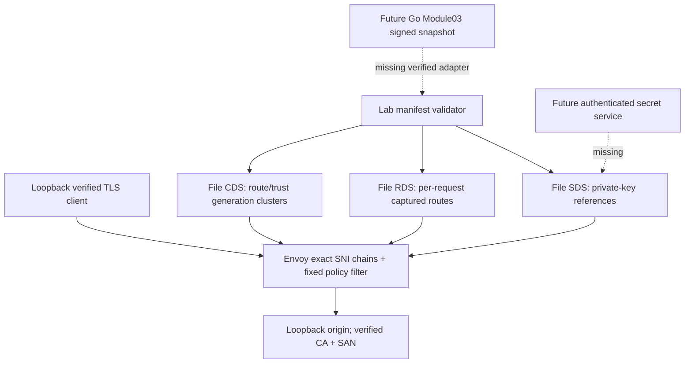

# Sprint03-A Agent B: Envoy executable comparison

Date:2026-11-11. Branch:`spike/envoy-feasibility`.
Scope:`/home/tiecont/Projects/aegis-gate-sprint03-b` only.

**Recommendation: NO-GO. Final shared result:69/75 pass,6 fail, exit1.**
All65 original IDs and10 supplemental IDs executed; no exclusions, skips,
parser patches, response suppression or harness changes were made by Agent B.
The isolated experiment is complete; the feasibility gate is not accepted.
Module01 stays closed, Module04 stays locked, and no architecture substitution
or production activation is authorized by this report. Root must independently
rerun the immutable commit before any merge.

## Agent Completion Report

- Module:01 alternative feasibility, Sprint03-A Agent B.
- Status:complete scoped PoC/evidence; mandatory capability gate NO-GO.
- Commits/files changed:`spikes/envoy/`, `evidence/sprint03a-b/`, this report.
  The delivery commit is reported with the final handoff; it contains this report.
- Architecture/ADR decisions:maintained Envoy1.40.2 APIs and official distroless
  image; no ADR or production data-plane replacement. Existing ADR011 remains.
- Contracts changed:none. Implements executable `manifest-path port` contract.
  Uses root's absolute current runner and own `AEGIS_RUN_ROOT` after that option
  became available. No root source or other agent worktree was edited.
- Positive tests executed:shared functional suite, encoded-target controls,
  bidirectional protocols, rotation, generation, verified origin trust changes,
  pools, health and workload. Exact command is in the spike README and
  [command ledger](../../evidence/sprint03a-b/COMMANDS.md).
- Security negative tests executed:all shared ingress negatives and TLS/host/
  certificate/config/body-size negatives.69 total tests pass; six failures below.
  Focused adapter tests:3/3 pass, exit0. All fixture/lab/Docker/scan commands
  after the initial unit invocation used the shared flock; the final unit run
  was repeated under flock and is the cited evidence.
- Performance data:shared workload plus supplemental measurement of actual
  container PIDs, described below; neither is launch-capacity evidence.
- Known risks/release blockers:strict ingress failures, policy Lua error behavior,
  body accounting, xDS/SDS/Module03 integration, signing/provenance and release
  quality gates remain open. No maintenance/security exception is requested.
- Human review needed:root independent review and reproduction, security review,
  then human architecture decision. No merge or GO before review.
- Next unblocked work:root comparative evidence review/proposed ADR only.
  This does not unlock Module04 or production migration.

## Mandatory failures

Authoritative output:
[run06 results](../../evidence/sprint03a-b/run-06-results.json),
[summary](../../evidence/sprint03a-b/run-06-summary.json),
[console](../../evidence/sprint03a-b/shared-run-06.log).

| Test ID | Observation | Disposition |
| --- | --- | --- |
| `malformed-HTTP-invalid-transfer-encoding` |501, zero origin handlers/bytes/errors |FAIL:contract requires4xx or closed empty response |
| `malformed-HTTP-obsolete-folded-header` |200, one origin handler,263 decrypted bytes |FAIL:obsolete fold accepted/normalized before policy |
| `strict-ingress-TE-repeated-chunked` |501, zero origin handlers/bytes/errors |FAIL:strict rejection response policy |
| `strict-ingress-TE-not-final-chunked` |501, zero origin handlers/bytes/errors |FAIL:strict rejection response policy |
| `supplemental-repeated-transfer-encoding-fields` |501, zero origin handlers/bytes/errors |FAIL:strict rejection response policy |
| `HTTP2-authority-Host-and-SNI-confusion-rejected` |Conflicting Host with authority/SNI returns200; one H2 handler |FAIL:conflicting original identity is discarded |

The four501 outcomes demonstrate no forwarding in those cases. They are not
evidence of an origin authorization bypass, but still fail the unchanged mandatory
policy. The H2 test aborts at its first accepted conflicting-Host variant, so later
variants inside that test do not establish individual results. No cross-tenant
exploit or general Envoy vulnerability is asserted.

Source evidence is [upstream.json](../../evidence/sprint03a-b/upstream.json),
with URLs, fetch timestamps, response hashes and line excerpts from v1.40.2.
The maintained Balsa parser explicitly sets
`disallow_header_continuation_lines=false`, and folds header continuation content
before filters. A filter over normalized headers cannot recover the original
fold. H2 codec source sets `allow_different_host_and_authority=true`; its
`http2_discard_host_header` path discards Host when authority exists. The UHV
configuration API is marked `not-implemented-hide`; no private build, deprecated
parser swap or temporary runtime rollback flag was adopted as a maintained fix.
No claim is made that every conceivable supported integration was exhausted.

## Executable configuration

The adapter is Node builtin-only code with no npm dependencies. Root's pinned
Node26.13.0 executable is used. `image.lock.json` pins official Envoy1.40.2,
released2026-10-27, source commit
`b2d89e0ae53916f28770771fbdd49c5c99c5c5a2`. Upstream's release policy covers
stable releases from the last12months. Binary `--version` independently reports
that commit,1.40.2,Clean,RELEASE,BoringSSL.

The adapter bounds manifest and fixture reads to64KiB; refuses symlinks, foreign
fixture paths, unknown fields, duplicate hosts, replay/nonmonotonic generation,
bad ports/weights, wrong SAN/time/key pairs and permissive key modes. Existing
host inventory is fixed for the process. It emits bootstrap and file CDS/RDS/SDS
resources using protobuf JSON, and publishes file replacements with rename.

Only127.0.0.1 listens. Exact SNI plus physical source127.0.0.1 selects one TLS
filter chain; no fallback chain or admin endpoint exists. TLS>=1.2 and ALPN are
explicit. Downstream session resumption is disabled so new handshakes see SDS
rotation. Origin SNI, CA and exact DNS SAN checks are explicit. No insecure
fallback exists. Each route/generation gets its own cluster and TLS context,
preventing pool sharing across route/trust epochs in the executed cases.

Envoy owns parsing, streaming, upgrades, pooling, health and cancellation.
A fixed Lua filter uses supported header/stream APIs for SNI-chain authority
binding, declared1MiB Content-Length rejection, untrusted header stripping and
draining denied connections. The code accepts no tenant scripts and inspects no
raw HTTP bytes. The documented `drainConnectionUponCompletion()` fixed the
earlier duplicate-Host pipeline successor forwarding; that test passes in run06.

Bounds include256downstream connections,64KiB connection buffer watermark,
32KiB/100header admission,64H2 streams,2s header/stream idle timers,
0.5s upstream connect,64connections/pending requests and128requests per cluster,
zero retries, health panic threshold0 and immediate health update merging.
Health probes use100ms intervals with explicit no-traffic timing and verified TLS.
The container is read-only, runs at caller UID/GID, drops capabilities, forbids
new privileges, and caps memory256MiB,CPU2,PIDs64. One Envoy worker is configured.
The launcher process remains outside these container limits.

## Evidence chronology

| Run | Outcome | Interpretation |
| --- | --- | --- |
|01 |Startup fatal |Bootstrap incorrectly used Any `@type` in a concrete listener; fixed |
|02 |59/75,16fail |Retained raw JSON/log; initial Lua nil bug, timing and earlier runner classification |
|03 |Incomplete; no final JSON |Retained console, proxy and resource logs; no full-run claim |
|04 |66/75,9fail |Corrected runner separates TLS aborts; health recovery default caused later benchmark failure |
|05 |68/75,7fail |Official distroless image; health merge window0 fixes health and workload |
|06 |69/75,6fail |Final candidate hashes captured at launch; denial drain fixes pipeline |

Runs02/04 captured only the shell launcher's historical hash. Their summaries do
not invent retrospective JS hashes. Runs05/06 capture launcher, compiler and lock
hashes with `AEGIS_CANDIDATE_ARTIFACTS`. Source bindings and current external input
hashes are distinguished in `dependencies.json`. Run03 ended before emitting an
evidence path and final inventory, so its log is marked incomplete.
Final cleanup found that interrupted run03's owned container still existed.
Its image and mounts were verified against this worktree before stopping that
specific container. Ownership/cleanup logs are retained; final container inventory
is empty. Completed runs06 and the supplemental benchmark stopped via SIGTERM.

Root corrected HTTPS `clientError` instrumentation between early runs: TLS aborts
without HTTP parser codes are transport errors, not malformed HTTP forwarding.
Earlier wrong/expired/untrusted-origin failures had zero handlers/decrypted bytes;
those raw failures are retained. Final three TLS negatives pass, with no bypass.

Final positive evidence includes both SNI certificates; unknown/missing/bad SNI
denial; pre-TLS source deny; six exact encoded targets and valid pipelining;
H1/H2 body streaming; WS echo/close; gRPC bidirectional messages/trailers and
origin cancellation; active-stream certificate rotation; invalid/replayed config
and invalid certificates retain LKG; trust-store changes invalidate origin pool
reuse; bounded timeout; route pool partitioning; eight upload cancellations;
exact30:10weight distribution, failover/recovery and TLS-invalid health denial;
no bytes forwarded before101; and log sentinel/key redaction checks.

## Image and dependencies

Final immutable index:
`sha256:09ca6f2140a61ad8df11779a4a30d52b48433d444466328494f9188c9c35eded`.
Linux/amd64 manifest:
`sha256:16e0d4dac937ffa34103aa6ba1013dc2030b9de2a249273c8d23c7c5c2989664`.
Scanned config:
`sha256:711883897f9d8a5cd5797f1ef41f49800f997291a8e9db812a8786c184466936`.

Pinned Trivy0.69.1 reports zero HIGH/CRITICAL package findings for this Debian13.7
distroless image; scan exit0. CycloneDX SBOM is retained. Existing repository
`scripts/image_identity.py` verified the Docker-exported index/platform/config
and ordered layer hashes against the scanned config; exit0. This avoids equating
the OCI index ID with the different image config ID. Release image signatures or
attestations were not verified. Trivy OS/package coverage is not a complete audit
of statically linked Envoy/BoringSSL/C++ dependencies. No clean-production claim
follows from this package scan.

The initially tested Ubuntu image digest
`sha256:8de97e654644827d62afdbf7e1d3dc9fee01a8690d410dd1c63a30dc6b6cecbb`
had two HIGH findings for CVE-2026-109518 in apt/libapt-pkg6.0,
installed2.4.14,fixed2.4.15ubuntu0.1. Its findings and inspection remain under
`ubuntu-image-*`; no ignore or exception was used. The final official distroless
variant removes those packages. Envoy's Apache-2.0 license metadata and full SBOM
remain for distribution/legal review. Gitleaks scoped scans cover owned source,
evidence and report, with redacted machine-readable reports.
Source/report whitespace checks pass. The full staged diff check flags literal
HTTP CRLF and tool-emitted blank lines in raw logs; these evidence bytes are
preserved and no formatting exception or test suppression was installed.

## Workload and resources

Hardware:AMD Ryzen7 4800HS,16logical CPUs,24,573,243,392bytes RAM,shared Linux host.
The root workload is100warmup,5s,8closed-loop clients,90%GET/1KiB,
10%POST/32KiB echo,verified TLS both hops,H1 keepalive. Root run06 reports
1,819.36requests/s,p95=7.638ms,p99=9.928ms,zero errors/timeouts.
**Its candidate CPU/RSS samples only the Node launcher, not Envoy.** They are not
presented as proxy resource evidence.

The supplementary identical-profile run in `benchmark-processes.json` samples
actual container PIDs from `docker top` and Linux `/proc`,HZ100,pages4096,
RSS every100ms. Actual Envoy PID3169536,launcher3169120; Nginx PIDs are recorded.

| Process/workload | Requests/s | p95/p99 ms | CPU % of one core | Peak RSS bytes | Errors/timeouts |
| --- | --- | --- | --- | --- | --- |
| Envoy,1worker |1,086.61 |14.037/19.807 |66.79 |74,563,584 |0/0 |
| Node adapter alongside Envoy |n/a |n/a |2.80 |66,293,760 at end |n/a |
| Nginx1.30.6,2workers+master |3,423.00 |4.111/6.092 |50.79 |20,336,640 |0/0 |

An earlier supplementary benchmark attempt failed to start its read-only Nginx
reference due to missing explicit temporary paths. It is preserved as
`benchmark-attempt-01.*`; the final driver supplies the same temporary paths as
the common harness. Its failure is not a successful benchmark.
The different throughput from the shared run demonstrates shared-host/scheduling
sensitivity. Sequential closed-loop5s runs,worker-count differences and shared
pages prevent a performance ranking,launch SLO,overload or leak/soak conclusion.
Upload cancellation is functionally observed at origin; the common64MiB RSS
assertion covers the adapter only. Separate whole-run actual Envoy samples are
retained, but do not establish a cancellation-specific64MiB bound.

## Module03 and migration gaps

| Boundary | Executed PoC | Required production adapter/work |
| --- | --- | --- |
| Trust envelope |Bounded local owned JSON and monotonic generation |Module03 schema/signature/hash/expiry/tenant checks,mTLS bootstrap and transport |
| xDS |File CDS/RDS; fixed listener inventory |Authenticated ADS/CDS/EDS/RDS/LDS,resource names per tenant,quotas,real ACK/NACK and observable readiness |
| Apply/LKG |Local validation before independent file swaps; existing live state on bad manifest |Dependency-aware staging,atomic policy/cert activation,drain and bounded old epochs,durable validated LKG,rollback as newer generation |
| SDS |Read-only files with permissions, SAN and key validation; live rotation test |Restricted secret service authorization, separate SDS identity, restricted memory, encryption, revocation, resumption and ACME lifecycle |
| Auth/policy |Fixed Lua authority/header checks |Fail-closed native/reviewed filter/ext_authz integration,JWT/API keys,rate budget outage policy; Lua runtime errors must not bypass security |
| Origins |Owned loopback only |T03 DNS/SSRF and socket destination validation,approved ports,rebinding-resistant resolution and egress controls |
| Limits |Finite transport/windows/timers/circuits and declared Content-Length limit |Streaming total body accounting for chunked/H2,global per-tenant concurrency/rate limits,overload/slow-client/soak proof |
| Usage/operations |No access logs; safe diagnostic messages and PID samples |Redacted OTel,audit,durable usage ledger,bounded labels,health/drain/crash/HA runbooks and release checks |

CDS is written before RDS references its immutable generation clusters; SDS is
another independent update. This is not a transactional multi-resource apply or
Module03 ACK. Temporary cluster warming/NACK/reload races beyond the executed
cases remain unproven. Added/removed hosts require a future LDS implementation
and are explicitly NACKed here. TLS/key files remain trusted owner-managed fixture
inputs; production immutable secret staging and filesystem race hardening are
not established. Loopback is a lab target, never an authorized public SaaS origin.

A migration would replace Rust Pingora hooks with Envoy filters and a maintained
Go xDS/SDS adapter. First obtain a maintained strict-ingress solution and rerun
every case; then design threat-reviewed contract mapping and a shadow-only local
adapter; prove revocation/LKG/rollback,tenant isolation and bounds; independently
review protocol/security/HA evidence; obtain human ADR approval before any edge
replacement. Rollback of this experiment is removal of its isolated directories;
no production path depends on them. Production traffic migration is not implemented.

Two alternatives remain reviewable:wait for maintained Envoy strict behavior and
an ingress proof covering these originals,or compare the separately owned
Pingora/Hyper alternatives against the identical complete harness. A custom raw
parser,private Envoy patch,hidden ingress proxy or acceptance-policy weakening
is not an implemented alternative. Root owns the comparative decision and human
approval gate.
