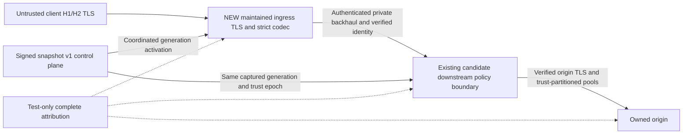

# Sprint 04-C C separate strict-ingress boundary assessment

Status: design/threat analysis COMPLETE; runtime feasibility NOT established.
Module01 NO-GO;04-12 LOCKED; production BLOCKED. No production front end or
candidate is implemented. Baseline main `a325b9ecc086e09467f61b49f17da241bf8e43ea`.

## Maintained codec screened and stop

Screened maintained HAProxy3.4.7 LTS as an actual complete proxy/codec option,
not a name placed ahead of Envoy. Official release archive SHA256 is
`ccfd342f3724c2cd659574044d788f44e20b212467c6bd5edbbfc517a2775dca`.
The [official release directory](https://www.haproxy.org/download/3.4/src/)
and [checksum](https://www.haproxy.org/download/3.4/src/haproxy-3.4.7.tar.gz.sha256)
supply immutable version/archive identity. The official homepage lists3.4 as
LTS and3.5-dev separately; a development version is not a released trigger.
These are source-inspection findings, not an executed HAProxy benchmark.

Exact shipped H1 state machine `src/h1.c` accepts continuation whitespace in
`H1_MSG_HDR_L1_LWS`/`H1_MSG_HDR_L2_LWS` and replaces CR/LF/HT with spaces before
header processing. The retained raw member SHA256 is
`7fa267f023b722d4f235ebbccf3969402a38eb2733973ca9713e8e7f5e678346`.
That inspected path supplies no demonstrated pre-normalization rejection for
the original folding policy. Do not infer that strict default syntax or
`no option accept-invalid-http-request` rejects every obsolete folded field.
No complete released folding/header/trailer/identity/TE policy was established.
HAProxy is therefore **not a technically qualified ingress substitute here**.
This is a scoped released-source stop, not a claim that no present/future
HAProxy feature or other maintained project could satisfy the requirement.

The released configuration exposes real TLS/identity/proxy controls, including
`ssl_fc_sni`, ALPN, server TLS verification, PROXYv2 SSL identity metadata and
HTTP reuse controls. Those partial APIs are useful design inputs, not proof of
end-to-end exact-SNI trust or unchanged75 compliance. Configuration excerpts
and line numbers are retained from the checksum-verified archive, alongside
source/tree/argv/Python/HTTP-status/time/hash receipts. The complete archive
and multi-megabyte manual are not committed; selected raw members and bounded
excerpts are retained. See `evidence/sprint04c-c/source-02/`.

A public-source GitHub lookup did not resolve the guessed stable tag location;
no missing-tag conclusion about maintenance follows. Source collector attempt01
failed on an incorrect optional archive member path after verifying the official
archive and retaining H1 source. Its failure remains unchanged. Corrected
source02 omits that unused path, checks immutable corpus/whitespace and supplies
eligible complete source-collection evidence. Neither collector builds a proxy.

## Proposed boundary and ownership (conditional design)

The front must terminate TLS to inspect HTTP. L4 passthrough cannot validate
HTTP inside encrypted streams. Adding this boundary changes certificate custody,
trusted client identity, configuration coordination and cancellation semantics.
Root owns this design handoff. Human architecture/security owners remain
PENDING. Runtime, certificate/identity, snapshot adapter, deployment and patch
owners must be assigned before implementation; no upstream maintainer is assumed
to own AegisGate integration. Origin remains outside the front's trust boundary.

## Required semantics across both hops

| Surface | Required behavior and ownership |
| --- | --- |
| TLS/SNI | Front selects exact verified domain/certificate, preserves authenticated handshake SNI, validates per-request authority/Host against that identity before any backhaul admission. Define resumption, renegotiation absence, rotation and disabled-domain behavior. |
| Client certificate/IP | Verify client cert at the terminating front if enabled. Strip all untrusted forwarding/tenant headers; transfer authenticated identity over mutually authenticated, access-restricted backhaul. PROXYv2/TLV data alone is not authentication. Bind sender identity and prohibit direct client access to backend. |
| H1 keepalive/pipelining | Maintained parser validates every message, body framing and trailer before irreversible normalization/forbidden egress; preserve original valid encoded targets and ordered replies. Test mixed valid/invalid pipeline and smuggling across parser differentials. |
| H2/HPACK | Maintain complete connection/stream/header compression state, bounds and CONTINUATION ordering. Validate pseudoheaders/Host/userinfo/SNI before opening backhaul streams. Preserve all-byte controls and generation/tenant attribution; H2-to-H1 translation must not create new ambiguity. |
| WS/gRPC | Explicit validated upgrade/tunnel lifetime, trailers and bidirectional streaming; no body-wide buffer assumption. gRPC routing and cancellation stay bound to original identity/generation. |
| Backpressure/cancel/drain | Bound both application queues and both transport windows. Client cancel propagates across both hops; prove actual origin cancellation, not just front handler exit. Drain rejects new work while leases retain exact generation through completion/deadline. |
| Pools/trust | Partition on tenant, verified origin identity, CA/trust epoch, protocol and configuration policy. Test reuse across denied requests and across cert/trust/config rotations. No cross-tenant coalescing assumption. |
| Signed config | Snapshotv1 remains unchanged. A reviewed adapter must validate authentic complete snapshots and stage front/backend activation without mixed-generation routing. Handle ACK/NACK, restart, LKG, expiry, rollback-as-new-generation and revocation latency at both hops. |
| Routing | Verified domain maps to one tenant/listener/route in the captured generation. Client-supplied tenant headers, original-host assertions or arbitrary upstream authority never establish tenancy. |
| Origin security | Both front-to-edge and edge-to-origin verify chain/SAN/expiry, dial-time destination policy and cancellation. Extra hop cannot weaken SSRF, credential redaction or safe retry/idempotency. |

## Threat-model delta (proposal, not accepted threat-model edit)

T01 gains a spoofable identity-transfer path unless backhaul sender and original
SNI/client identity are authenticated. T07 gains two parsers and H1/H2 translation,
so independently valid normalized output can conceal malformed original input.
T08 gains another header/HPACK/window/buffer budget, downgrade path and timeout
race. T11 gains dual config generation/expiry/rollback coordination. T16/T17
gain two sets of idle pools, drain states, half-closes and cancellation races.
TLS custody and logs gain an extra plaintext location and another patch cadence.

Required negatives include direct backend bypass, forged PROXY/TLV/Forwarded
identity, mismatched SNI/Host/:authority, cross-tenant pool reuse, front/back
config skew, one-hop trust retirement, retry duplication, ambiguous CL/TE,
folded headers AND trailers, partial H2 headers/HPACK mutations, silent capture
loss and valid-control misattribution. Preserve raw input to prove rejection
before normalization; normalized backend headers alone cannot establish it.

## Migration and maintenance comparison

| Path | Added owned work | Maintenance/stop |
| --- | --- | --- |
| Maintained Envoy strict API | Existing spike plus supported codec/config policy; eventual xDS/SDS/policy adapter remains substantial. | One proxy boundary, released strict hook missing; B owns exact requirements, not upstream delivery. |
| Maintained Pingora strict path | Existing Rust hooks plus target/framing/pipeline corrections and warning dispositions. | Lower architecture migration but released parser/maintenance gaps remain. |
| Maintained Hyper incoming strict path | Full proxy assembly, TLS, health, pools, upgrades/cancel and raw incoming policy. | Largest application-owned integration;70/75 does not establish lower risk. |
| Separate maintained front | Two runtimes, two TLS/identity boundaries, dual activation/LKG, streaming/pooling/drain, provenance transport and operational support. | Highest combined attack/patch/observability burden. Must first prove a released strict codec; HAProxy screen did not establish one. |

No option is chosen by raw PASS count. A second maintained proxy does not repair
provenance already lost by its own parser. A maintained parser library alone
(e.g. header parsing without body/trailer/H2 lifecycle) is not a complete
strict-ingress front end. Custom raw scanning/private codec forks are excluded.

## Conditional PoC acceptance plan

Current disposition: **NO-GO for PoC implementation; no released strict trigger
established and no separate architecture authorization**. Resume only when B/C
can cite a supported released strict capability with exact provenance and the
human approves this new boundary for isolated proof. Then:

1. Pin source/image/API and demonstrate all historical folding, framing, TE
   response/close and identity failures first on loopback, under full-lifecycle lock.
2. Run the original75 unchanged across BOTH boundaries, retaining origin bytes,
   handlers/parser/errors/new dials and all failed history. Preserve valid encoded
   target and ordered pipeline/WS/gRPC/H2 reuse controls.
3. Execute every threat-delta negative above, verified TLS/mTLS/cert rotation,
   cancellation/backpressure/drain, trust-partition pools, config skew/LKG/expiry,
   bounded memory/window/deadline tests and all relevant mandatory resource probes.
4. Validate a complete maintained observer against deliberate partial HEADERS,
   HPACK and dial leaks; unknown mappings/capture loss remain FAIL. Original
   zero-byte failure remains mandatory regardless of proposed Option2 diagnostics.
5. F independently reproduces exact sources, then full local/hosted gates and
   recorded affirmative human runtime decision. This plan establishes no
   feasibility result, Module04 eligibility or production approval.

## Agent completion report

- Module/status:01 alternative boundary design complete; runtime NO-GO.
- Changes: this report, bounded source collector and retained official evidence.
- Contracts/product changed: none. Snapshotv1 and original75/23 unchanged.
- Positive validation: official archive digest/member inspection, corpus and
  authored whitespace checks in source02; exact exits are in its receipt.
- Negative runtime/performance proof: none claimed; no proxy was built or run.
- Human review: explicit new-boundary scope/owners if a released strict trigger
  appears; F design/source review still required before integration.
