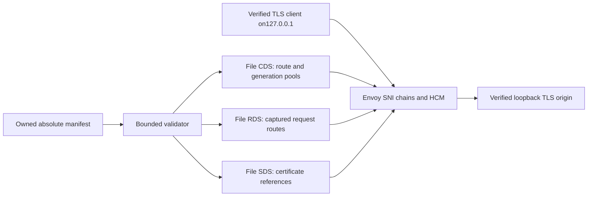

# Envoy isolated feasibility proof

**NO-GO:69/75 shared tests pass; six mandatory failures remain.**
This is executable comparison code, not a production edge or architecture change.
See [completion report](../../docs/reports/sprint03a-b-envoy.md).

`launch absolute-manifest-path port` implements root's candidate contract.
Only127.0.0.1 is bound. Unknown/missing SNI and physical source addresses other
than127.0.0.1 have no matching filter chain. No admin listener exists.
`SIGTERM` stops the owned Docker container. Runtime diagnostics go to stdout/stderr.

## Reproduce

Prerequisites: Linux Docker host networking and `/proc`, Docker access, `flock`,
OpenSSL CLI, root's installed fixture dependencies and pinned Node toolchain.
The default Node path is root's absolute toolchain; `AEGIS_NODE` may override it.
All Docker, tests with fixtures, benchmarks and scans must hold the shared lock.

```sh
flock /tmp/aegisgate-sprint02-fixtures.lock env \
  AEGIS_RUN_ROOT=/home/tiecont/Projects/aegis-gate-sprint03-b/.local \
  AEGIS_CANDIDATE_NAME=envoy \
  AEGIS_CANDIDATE_ROOT=/home/tiecont/Projects/aegis-gate-sprint03-b \
  AEGIS_CANDIDATE_COMMAND=/home/tiecont/Projects/aegis-gate-sprint03-b/spikes/envoy/launch \
  AEGIS_CANDIDATE_ARTIFACTS='["/home/tiecont/Projects/aegis-gate-sprint03-b/spikes/envoy/launcher.mjs","/home/tiecont/Projects/aegis-gate-sprint03-b/spikes/envoy/config.mjs","/home/tiecont/Projects/aegis-gate-sprint03-b/spikes/envoy/image.lock.json"]' \
  /home/tiecont/Projects/aegis-gate/.local/toolchains/node/bin/node \
  /home/tiecont/Projects/aegis-gate/spikes/edge-comparison/run.mjs
```

Expected exit1 for the current six failures; no exclusions or skips.
`AEGIS_CANDIDATE_ARGS` is unnecessary. The shell launcher accepts the two arguments
unchanged, regardless of working directory. The fixture manifest is not the signed
Module03 snapshot format. See `example-manifest.json` for shape only; certificates
and private keys must be created locally, never committed.

```sh
flock /tmp/aegisgate-sprint02-fixtures.lock \
  /home/tiecont/Projects/aegis-gate/.local/toolchains/node/bin/node \
  --test spikes/envoy/config.test.mjs
flock /tmp/aegisgate-sprint02-fixtures.lock spikes/envoy/scan.sh
```

`collect.mjs harness-log output-prefix` preserves shared JSON, runtime logs and
actual Envoy PID resource samples without copying fixture keys. Historical hashes
come only from the harness's launch-time artifact inventory.
`benchmark.mjs shared-results.json output.json` reuses owned ignored certificates
to run a separate identical workload against Envoy and the pinned Nginx reference,
sampling the actual container processes and the adapter separately. It also needs
the lock. This supplementary benchmark does not replace the shared benchmark.

## Integration

`image.lock.json` pins supported Envoy1.40.2 distroless by immutable OCI index.
The container runs as the caller UID/GID with read-only filesystem/mounts,
no capabilities, no new privileges,256MiB memory,2CPU and64PID caps. One Envoy
worker is used. The adapter samples the actual host container PID every100ms.

The bounded JSON adapter validates monotonic generation, exact hostname
inventory, ports, backend weights, key permissions, certificate SAN/time/key match,
and fixture path/size/type. It produces Envoy protobuf JSON, never an HTTP parser.
Each SNI owns one HCM and separate route-scoped, generation-specific cluster.
CA and exact DNS SAN verification are explicit for origin requests and health
probes. Health panic fallback is disabled, and health update merging is disabled.
H1/H2 streaming and WebSocket upgrades use Envoy's maintained codecs/router.
The small fixed Lua filter uses supported header/stream APIs for authority
binding, declared body limit, untrusted-header stripping and denial draining.
It does not parse raw bytes or receive tenant-supplied code.



## Boundaries

File CDS/RDS/SDS are independently staged, not an atomic signed multi-resource
transaction. Host inventory changes are NACKed; use LDS in a future adapter.
No production xDS server, SDS secret service, authenticated propagation,
durable LKG/ACK/NACK, DNS SSRF enforcement, JWT, rate limits or metering exist.
Total chunked/H2 body size is not capped by the declared Content-Length check;
flow control and connection/circuit limits do not establish a total body bound.
Lua runtime failures can fail open and are a production policy integration gap.
The loopback origin rule is confined to this executable and must never become
a SaaS SSRF exception. Read the report's Module03 and migration gap matrix before
considering any replacement. Module01 stays closed and Module04 stays locked.
